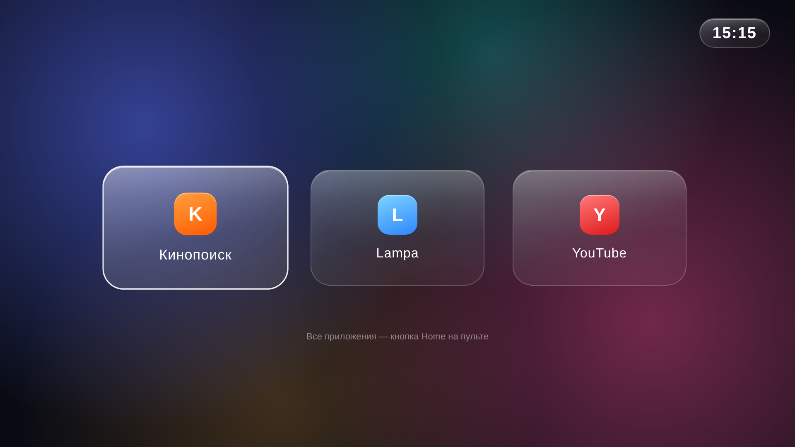

# LG webOS: свой главный экран и чистка старого телевизора

Проект для старого LG на webOS 3.x. Делает две вещи:

1. **Чистит систему.** Отключает фоновые службы телеметрии, распознавания контента (ACR / Live Plus), трансляции и предзагрузки. Удаляет ненужные предустановленные приложения.
2. **Ставит свой главный экран** в духе Apple TV. На нём несколько крупных «стеклянных» плиток с логотипами нужных приложений и часы. Экран открывается при включении телевизора и по кнопке Home на пульте.



*Предпросмотр в браузере. На телевизоре вместо букв показываются родные иконки приложений, при этом они берутся с самого телевизора.*

## На чём проверено

| | |
|---|---|
| Модель | LG 49UH619V (2016–2017) |
| webOS | 3.4.3 (dreadlocks-digya) |
| Прошивка | 05.70.50 |
| Пульт | обычный ИК-пульт (`LGE RCU`) |
| Плитки | Кинопоиск, Lampa, YouTube |

На других моделях с webOS 3.x скорее всего тоже заработает, но это не проверялось.

## Что нужно заранее

- **Root через Homebrew Channel.** Этот проект root не получает, он работает поверх уже рутованного телевизора. Подходит ли ваша модель и прошивка и каким способом рутуется, смотрите на [CanI.RootMy.TV](https://cani.rootmy.tv/) и в документации [webosbrew](https://www.webosbrew.org/). В настройках Homebrew Channel должны быть включены root-режим и SSH.
- **SSH на порту 22.** После рутования через Homebrew Channel пароль root по умолчанию `alpine`. Лучше поменять его или настроить вход по ключу.
- **Компьютер с Windows** со встроенными `ssh` и `scp` (есть в Windows 10/11).

## Как пользоваться

Один раз укажите IP телевизора в `windows/config.bat`. Дальше запускайте нужный `.bat` из папки `windows`. Вывод каждого скрипта сохраняется в `windows/output/`.

| Скрипт | Что делает |
|---|---|
| `check-ports.bat` | Проверяет, доступен ли телевизор и открыт ли SSH (порт 22) |
| `inventory.bat` | Только читает: приложения, автозагрузка, службы, память |
| `install-debloat.bat` | Ставит отключение служб в автозагрузку и сразу выполняет его |
| `remove-debloat.bat` | Убирает отключение служб; они вернутся после перезагрузки |
| `install-homescreen.bat` | Ставит главный экран, автозапуск и перехват кнопки Home |
| `uninstall-homescreen.bat` | Полностью убирает главный экран |
| `probe-keys.bat` | Только читает: 20 секунд записывает нажатия пульта, чтобы узнать код кнопки |
| `screenshot.bat` | Снимает скриншот главного экрана в `windows\output\homescreen.jpg` |
| `reboot.bat` | Перезагружает телевизор |

Если после перезагрузки не открывается SSH, один раз откройте на телевизоре Homebrew Channel.

### Как ведёт себя экран

- При включении телевизора, в том числе при выходе из режима ожидания, открывается наш экран.
- Кнопка Home в любом другом приложении возвращает на наш экран. Штатная лента может мелькнуть на долю секунды.
- Кнопка Home на нашем экране открывает штатную ленту LG: там все приложения, настройки и HDMI.

### Как поменять плитки

1. В `app/com.anton.homescreen/index.html` у каждой плитки задайте `data-app="<id приложения>"` и подпись. Id установленных приложений показывает `inventory.bat`.
2. В `tv/copy-icons.sh` поправьте строки `copy_one` и `color` под новые id.
3. Снова запустите `install-homescreen.bat`.

## Как это устроено

```
app/com.anton.homescreen/   веб-приложение главного экрана (HTML/CSS/ES5)
tv/install.sh               установка на телевизоре
tv/uninstall.sh             удаление
tv/copy-icons.sh            берёт иконки и фирменные цвета у установленных приложений
tv/homescreen-watch.sh      фоновый скрипт: автозапуск и перехват кнопки Home
tv/debloat.sh               список отключаемых служб (запускается при загрузке)
tv/inventory.sh, probe-keys.sh, screenshot.sh   диагностика, только чтение
windows/*.bat               запуск всего этого с ПК по SSH
```

- Приложение кладётся в `/media/developer/apps/usr/palm/applications/`, туда же, где лежит Homebrew Channel.
- Для него создаются разрешения шины Luna в `/var/luna-service2-dev/`. Без них экран не может запускать другие приложения.
- Автозагрузка идёт через `/var/lib/webosbrew/init.d/`. Это штатный механизм Homebrew Channel: корневая файловая система только для чтения, и `/etc/init` не изменить.
- `homescreen-watch.sh` подписывается на состояние питания (`com.webos.service.tvpower`). Ещё он читает события пульта из `/dev/input` и ждёт код Home `0x0305`. Нажатие Home перехватывается только тогда, когда на переднем плане не наш экран.
- Иконки приложений в репозитории не хранятся. Это логотипы их владельцев, поэтому при установке они копируются из папок самих приложений на телевизоре.

## Грабли, на которые наступили (webOS 3.4)

Самое ценное для тех, кто будет делать похожее.

1. **`/media/cryptofs/apps` — не для своих приложений.** Так система считает приложение купленным в LG Store и при запуске проверяет DRM. Результат — ошибка `-302 Failed to identify a proper DRM file`. Свои приложения надо класть в `/media/developer/apps`.
2. **Новое приложение видно только после перезагрузки.** Папки с приложениями сканируются при старте системы, поэтому до перезагрузки запуск возвращает `-101 not exist`.
3. **Без role-файлов запросы к шине молча пропадают.** `PalmServiceBridge.call()` не получает ответа вообще, даже ошибки. Приложению нужны `roles.d/<id>.app.json` и `client-permissions.d/<id>.app.json` в `/var/luna-service2-dev/`, после них — `ls-control scan-services`.
4. **`appInstallService/dev/install` без Developer Mode не работает.** И `luna-send`, и `luna-send-pub` просто молчат до таймаута. Поэтому установка тут ручная: файлы, `packageinfo.json` и роли.
5. **`defaultApps.home` на webOS 3.4 не работает.** Настройка записывается, но Home всё равно открывает ленту: на этой версии лента встроена в системную оболочку (surface manager), а не является отдельным приложением. Поэтому и `com.webos.app.home` запустить нельзя. Отсюда перехват кнопки через `/dev/input`.
6. **`luna-send` читает stdin.** Если передать скрипт по `ssh ... "sh -s" < script.sh`, первый же `luna-send` заберёт остаток скрипта, и дальше ничего не выполнится. Помогает `luna-send ... < /dev/null`.
7. **Busybox `timeout` пишется как `timeout -t 90`**, а не `timeout 90`.
8. **В `.bat` не экранируйте `^` внутри двойных кавычек.** Иначе символ `^` уходит в удалённую команду и ломает её. Длинные команды проще держать в `.sh` и передавать файлом.
9. **Производительность.** Большие `radial-gradient`, размытые `box-shadow` и анимация теней на старом движке тормозят. Фон лучше отрисовать заранее в картинку, а анимировать только `transform` со слоем `translateZ(0)`. `backdrop-filter` здесь нет, поэтому «стекло» имитируется полупрозрачными градиентами.
10. **Чистка мало даёт по памяти.** На 1 ГБ RAM отключение служб освобождает немного. Главное — приватность и меньше фоновой активности. Отзывчивость интерфейса заметнее всего улучшает свой лёгкий экран.

## Откат

- **Главный экран:** `uninstall-homescreen.bat`, затем перезагрузка. Штатный интерфейс LG не меняется, так что больше восстанавливать нечего.
- **Отключение служб:** `remove-debloat.bat`, затем перезагрузка.
- **Удалённые предустановленные приложения** (например, «Первый», more.tv) возвращаются установкой из LG Content Store.

## Ответственность

Всё делается на свой риск. Root и изменения системы могут повлиять на гарантию и на обновления прошивки. Автоматическое обновление прошивки может закрыть уязвимость, через которую получен root.

## Лицензия

[MIT](LICENSE). Логотипы и названия приложений (Кинопоиск, Lampa, YouTube, LG) принадлежат их владельцам и под эту лицензию не подпадают.
